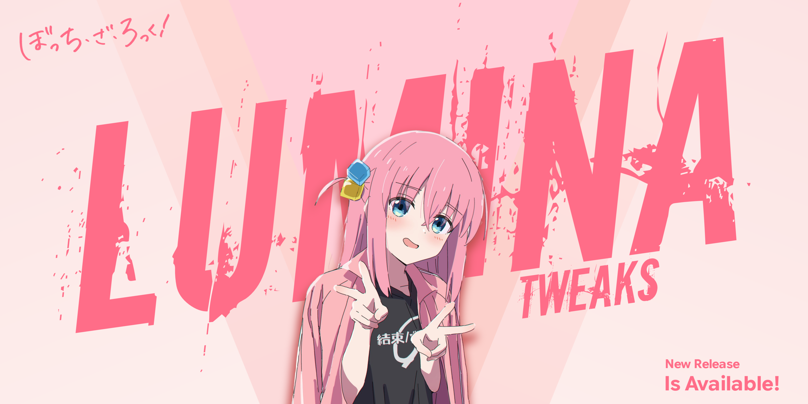

  

  
  
  
  

---

## ⚡ Overview

**LuminaTweaks** is a modern runtime tweak suite for dynamic performance and graphics tuning, driven by a low-overhead native Rust daemon (`luminad`) and a Jetpack Compose dashboard. It provides granular system profiling, advanced texture LOD tuning, and hardware diagnostics to ensure optimal gaming stability without sacrificing system integrity.

---

## 📖 Quick Guide

### 🤖 Optimization

* **Universal Boot Baseline:** Automatically configures TCP BBR, applies low-latency storage I/O schedulers (Kyber / mq-deadline), and locks thermal zones to a predictable `step_wise` governor at boot.
* **Dynamic Profile Switcher:** Automatically switches system profiles (**Performance**, **Performance Lite**, **Balanced**, or **Eco**) based on active foreground state.

### 🌐 Core Features

* **Texture LOD Offset (ANGLE Pipeline):** Fine-tune texture Level of Detail from **-3** (forcing maximum 16x Anisotropic Filtering quality) up to **+4** (reducing TMU/DRAM GPU bandwidth overhead).
* **Pixel Sharp Mode:** Force raw nearest-neighbor texture filtering for sharp, pixel-clean rendering without unwanted blur.
* **Refresh Rate Controller:** Supports global display refresh rate presets and granular Per-App configurations with real-time hardware Hz polling.
* **Memory & ZRAM Management:** Optimizes memory swap behavior and compression algorithms for responsive multitasking.
* **Thermal Throttling Toggle:** Safely toggle aggressive thermal throttling restrictions for sustained framerate stability.
* **Hardware Diagnostic Suite:** Integrated dashboard to inspect live battery health cycles, UFS storage integrity, and kernel system logs.

---

## 📦 Installation

This is a root module compatible across modern Android root environments. Install via your preferred root manager:

* **KernelSU**
* **APatch**
* **Magisk**

---

## 🛠️ Contributing & Bug Reports

We welcome contributions to make **LuminaTweaks** even better!

* **Report Bugs:** Open an [Issue](https://github.com/kimal404/lumina-tweaks/issues) with detailed logs from `/data/adb/luminatweaks/luminad.log` or logcat.
* **Pull Requests:** Fork the repository, create a branch for your feature, and submit a PR with clear documentation.

---

## 🙏 Credits & Acknowledgements

### Core Developers

| Role | Developer |
| :--- | :--- |
| **Author** | [@kimal404](https://github.com/kimal404) |

### Source Code & Inspirations

| Project / Developer | Reference |
| :--- | :--- |
| **AZenith** | [@Liliya2727](https://github.com/Liliya2727) |
| **Encore Tweaks** | [@Rem01Gaming](https://github.com/Rem01Gaming) |

---

## 📢 Stay Updated

Get the latest updates, experimental builds, and discussions through our official channels:

  
  

---

## ⚖️ License

This project is licensed under the **Apache License 2.0**.

> Licensed under the Apache License, Version 2.0 (the "License");
> you may not use this file except in compliance with the License.
> You may obtain a copy of the License at <http://www.apache.org/licenses/LICENSE-2.0>
