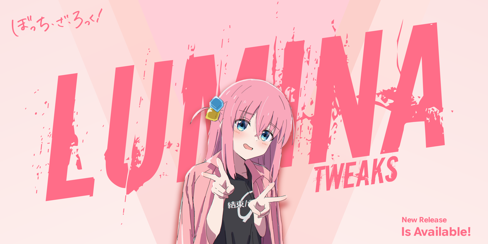

  

  
  
  

---

## What is LuminaTweaks?

LuminaTweaks is an Android root module built to stabilize framerates and eliminate gaming stutter. It automatically boosts hardware performance when you open a game and restores balanced settings during normal use to save battery.

---

## Installation

Compatible with Android 11+ on the following root managers:

- KernelSU / KernelSU Next
- APatch
- Magisk

Flash the release zip via your root manager and reboot.

---

## Credits

- **Author:** [@kimal404](https://github.com/kimal404)
- **[AZenith](https://github.com/Liliya2727/AZenith)** by [@Liliya2727](https://github.com/Liliya2727) — Referensi source code tweaks dan sebagian UI.
- **[Encore Tweaks](https://github.com/Rem01Gaming/encore)** by [@Rem01Gaming](https://github.com/Rem01Gaming) — Referensi source code tweaks.
- **[Project Raco](https://github.com/LoggingNewMemory/Project-Raco)** by [@LoggingNewMemory](https://github.com/LoggingNewMemory) — Referensi source code tweaks.

---

## Links

- [GitHub Repository](https://github.com/kimal404/LuminaTweaks)
- [Telegram Channel](https://t.me/MallArchiven)

---

## License

Licensed under the [Apache License 2.0](LICENSE).
